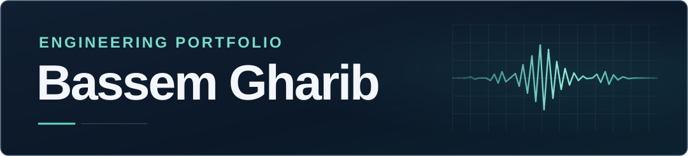

# 

**Cybersecurity · Industrial Security (OT/ICS)**

I’m building skills in defensive cybersecurity and industrial control systems. My background is in exploration geophysics and laboratory QA/QC.

## Cybersecurity & OT/ICS

My focus is on defending operational technology (OT) and industrial control systems (ICS).

- **Linux and networking** — Practicing with Ubuntu/WSL and Kali Linux while building a foundation in networking and network security.
- **Industrial systems** — Studying OT/ICS security and how industrial networks and cyber-physical systems are monitored and protected.
- **Python** — Building scripting skills for automation, data analysis, and security tasks.

## Selected project

### Soil & Concrete QA/QC Testing App

**In development** · Flutter and Dart

The planned workflow brings test inputs, calculations, and results review into one place and supports standardized laboratory reports for soil and concrete testing.

## Technical background

**Exploration Geophysics**  
Mineral exploration and subsurface mapping.

**Laboratory QA/QC**  
Soil and concrete testing, technical documentation, and result traceability.

## Connect

[LinkedIn](https://www.linkedin.com/in/bassem-gharib) · [Linktree](https://linktr.ee/bassemgharibtech) · [Email](mailto:b.gharib.dev@gmail.com)
